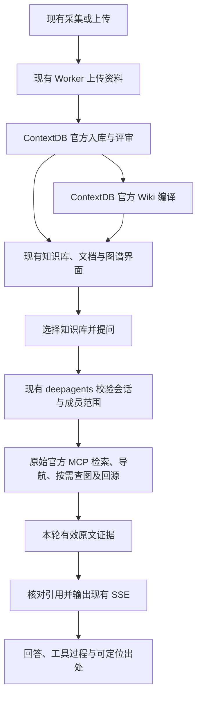

# ContextDB + WeKnora 平台当前架构

核对日期：2026-11-14。前端来自 Tencent/WeKnora 固定提交 `cbdcebabf48c5ee2d6868b370326aa8341703f62`，依赖锁及 MIT/第三方声明随源码保留。新页面使用上游壳、表单、列表、抽屉与现有组件扩展。

## 边界与数据

- ContextDB 是知识资产的唯一权威服务：解析、切片、检索、评审、Wiki 页面及版本、实体与关系、评审策略与模板。
- Flask 执行平台登录、成员凭据加密、官方请求转发、采集任务及同步编排。
- Docker PostgreSQL 保存平台账号/token、采集任务/来源映射、发布批次、双库投递记录、会话/执行记录、操作审计以及 **LangGraph 官方 PostgresSaver/AsyncPostgresSaver** 表。必要对话上下文属于会话记录，不建立知识全文库、检索索引、图谱表或评审替代服务。
- 原件、源快照和发布 ZIP 保存在 `downloads/`；版本记录在 PostgreSQL 中只保留来源与文件指针。平台 Worker 的采集模式不运行 Docling 或本地切片；原独立爬虫 CLI 的离线导出行为保留。
- deepagents 知识访问只装载 ContextDB 官方 MCP 工具。按平台角色裁剪写工具，绑定当前成员密钥，并约束所选知识库；原始 Schema 和错误语义由官方工具提供。写工具通过 deepagents interrupt/Command 恢复机制批准或拒绝。
- 平台不接入长期记忆、记忆整理或记忆晋升，相关页面、REST 代理与 Agent 工具已移除。聊天记录和会话 checkpoint 保留；历史晋升形成的知识文档继续按普通知识文档读取和编辑，不删除云端已有数据。

## 页面与官方契约

| 页面/操作 | 官方路径或工具 | 权限与状态 |
|---|---|---|
| 知识库卡片、详情、创建/改名/删除 | `/v1/knowledge/knowledge_bases`、`detail` | 读/写/管理以官方校验为准；Wiki 与 graph 互斥，不改现有模式 |
| 上传、文档更新、元数据、失败重试 | `/v1/knowledge/files` POST/PUT、`documents/metadata`、`documents/retry` | 成员写权限；保存 document_id 与事件 ID；上传受理不等于入库 |
| 文档列表、原件与切片 | `documents`、`documents/detail`、`documents/chunks` | 读权限；预签名原件由服务端获取，不向前端暴露成员密钥 |
| 目录 | `knowledge/nodes` GET/POST/PATCH | 按官方节点 ID 分页，改名/移动携带 `expected_tree_version`；不用 `file_path` 推导目录 |
| 检索与出处 | `/v1/knowledge/query`；Agent 使用 `knowledge.search` MCP | 知识库 ID、分页/上限及错误保留；文档、切片 ID 使用官方值 |
| Wiki 索引、目录树、搜索与完整页 | `wiki/index`、`wiki/pages`、`wiki/search`、`wiki/pages/detail` GET；Agent 仍用 `knowledge.wiki_search` MCP | 按官方游标分组/逐层浏览；搜索最多50页，不代替全量目录；详情按 `published` 展示正式正文 |
| Wiki 创建与编辑 | `wiki/pages` POST/PUT | 全文读取后提交真实 `expected_version`；冲突保留草稿，用上游差异工具比较并合并，无版本扫描或强制覆盖 |
| 修订与正文差异 | `wiki/revisions`、`wiki/revisions/diff` GET | 指定页面与修订 ID 比较；超过800行显示截断，无原生回滚入口 |
| Wiki 目录与页面整理 | `wiki/directories`、`directories/actions`、`pages/actions` POST；`wiki/pages` DELETE | 使用页面及目标目录版本；归档保留历史，删除不可恢复，事件受理后回读 |
| Wiki 编译控制 | `wiki/compile-runs` GET、`compile-runs/actions` POST | 官方来源状态和统计；pause 不终止在途任务，resume 不自动补派积压，不作为编译隔离保证 |
| Wiki 内容问题处理 | `wiki/issues`、`issues/detail` GET，`issues/actions`、`issues/tasks` POST，`issue-tasks/detail` GET | 使用问题版本和幂等键，核对来源证据及逐项任务结果；不当作全库候选审批 |
| 实体图谱与来源 | `graph-visual`、`entities`、`entities/detail`、`entity-relations/detail`、`entities/chunks` | 读权限；支持文档范围、实体检索和 1/2 跳展开；复用上游布局，抽取与归并由 ContextDB 执行 |
| 图谱提取与全库更新 | `knowledge/events`（`graph_build`）、`knowledge/graph/consolidate`、`event/{id}` | 读写角色；提取与全库归并分开跟踪，受理不代表完成，未派发不当作成功 |
| 知识评审 | `knowledge/reviews`、`detail`、`action`、`resolve-conflicts` | 区分自动接受/待人工/通过/拒绝/撤回/失败；冲突处置草稿不等于发布 |
| 策略与模板 | `knowledge/review_settings`、`review_templates` | 模板章节、默认标记直接官方读写；不本地渲染/执行治理算法 |
| 有效权限、组与授权 | `workspaces/members/self/permissions`、`groups`、`groups/members`、`knowledge_acls` | 不模拟身份切换，不自动启用不可逆的高级权限模式 |

## 同步与运行恢复

前台统一为“知识库”入口，以业务卡片聚合一个 Wiki 库与可选图谱库。内部空间配置与资源映射仍保存在 Docker PostgreSQL 的既有平台运行记录中，不保存替代知识资产。`/platform/knowledge-bases` 展示业务卡片，旧 `/platform/knowledge-spaces` 列表重定向；scope 详情、原官方库 ID 和引用深链保留。未绑定官方库通过“关联已有库”查看或关联。新范围默认只提交 Wiki；已有范围保留双库行为与资源 ID。关闭图谱不删除资料，也不取消已经受理的批次。两边官方模式互斥，因此仍分别记录目标、文档 ID 和处理状态。

官方目标库被外部删除时，只有明确不存在响应才标为 `missing`，401/403 或网络故障不作删除处理。空间和进度保留历史投递回执与旧库 ID，跳过已缺失目标的逐文档读取；页面访问不自动建库。恢复需明确重新关联或提交，受在途同步保护；新旧库记录不互相覆盖，历史 ID 可继续解析到业务空间。当前默认 Wiki 已由用户或并行任务恢复为新目标，既有图谱库不变。

采集与文件上传都经 `/platform/collect?space=<scope>` 接入，后端校验当前账号的范围归属。文件原件保留在受控目录，格式处理能力由 ContextDB 判定；平台入口仍有一次 50 个文件、请求总计 100 MB 的传输限制。新来源身份包含业务范围，同源导入不同空间不会互相覆盖；同范围已有来源 ID 保持不变。

任务页的“提交治理”调用 `/tasks/<id>/submit`，旧 `/publish` 路径作为兼容别名保留。每次提交固定目标清单，同范围当前资料形成来源快照。官方模式不匹配时阻止投递，不悄悄换库。相同已受理哈希在待评审期间也不重复提交；只对明确的重复创建冲突进行定位更新。上传与更新结果未知时先读回官方记录，不能补造成功或盲目重写。

空间治理进度分别展示本地上传记录与官方评审、入库、Wiki 编译、图谱构建字段；缺失字段显示未返回。失败上传只重试选中的目标；入库重试须有官方 `recovery_actions=retry` 提示。已入库但图谱跳过、显式未构建或失败的文档可派发官方 `graph_build`；处理中不重复提交。图谱页“更新全库图谱”归并已有文档提取结果，按官方事件跟踪并在成功后刷新；开启开关本身不补建历史文档。待人工评审不自动重试；Wiki 专项重编和失败重试使用 0.0.9 `wiki/compile-runs/actions`，不以重传资料替代。空间开通图谱后，可“重新提交最近批次”补充已启用目标，不必重新采集；该动作不包含尚未提交的采集结果。

提交操作按账号与采集任务加 PostgreSQL 锁；重复提交复用批次，缺失的同步任务可补齐。失败重试拒绝已被新批次替代的旧快照，避免覆盖新资料；历史记录里的显式重新提交另有确认提示，不宣称完成云端历史回滚。部分失败保留成功侧映射，重试只处理尚未受理的变化。

会话归属在服务端验证；密码采用 Werkzeug 哈希，成员密钥 Fernet 加密。失效/禁用账号的 token 被撤销。Agent 的写工具恢复只接受一次原始批准/拒绝；重新连接只 GET 已受理执行，不重发用户问题。执行进度定期保存；失联运行标记中断，知识写入结果未知时须核实官方记录，不能自动宣称恰好执行一次。

聊天显式提交 `knowledge_base_ids: []` 会清空范围，不连接或装载官方知识工具；省略字段保留会话已选范围。非空范围在 MCP 拦截器强制注入及验证库 ID，文档 ID 通过当前成员的官方文档详情验证归属；无法约束的全局工具不装载。REST 文档详情仅用于归属鉴权，不作知识检索回退。

## 本轮 WeKnora 业务规则复用

`agent/citations.py` 参考同一固定提交的 `internal/modelcontext/citations.go`，将原文证据登记、流式引用标签完整输出、无效引用过滤与代码字面内容保护移植到现有 SSE 处理。ContextDB 使用真实 ID，不移植上游标题/序号推断出处的兼容规则。只登记所选库内、本轮成功 `knowledge.search` 或 `knowledge.list_entity_chunks` 返回且具有完整库/文档/切片标识与非空正文的切片；Wiki 搜索摘要和图谱合成描述不登记。官方标题和定位字段据实传递，未提供的坐标不补造。

普通问题、Wiki 导航和关系查询都使用现有 deepagents 执行。指令分别指定官方 `knowledge.search`、`knowledge.wiki_search`、按需 `knowledge.list_graph_entities → knowledge.get_graph → knowledge.list_entity_chunks`，证据足够就停止；工具目录、名称、Schema 和原始输出不变。成功官方结果含 `truncated=true` 时，在现有回答 SSE 中追加一次固定范围说明，并随正文保存；不依赖模型自行表述限制。引用仅验证出处身份和本轮可用性，不能自动证明自然语言结论得到原文语义支持。

人工确认恢复时，只从同一用户回合的 checkpoint 恢复成功原文工具证据，并重新校验所选库；普通新回合不会继承历史引用。SSE、保存的对话和重连记录使用同一份过滤后正文。工具异常、流中断、取消和未返回结果的终态均停止 pending 状态；恢复记录重放真实工具结果。现有进度监控每 0.5 秒检查停止标志，因此即使上游不再产生事件也能取消本地执行；这不证明远端已接受的写操作被撤销。

Wiki 编译器准入尚未通过，当前仅由 **ContextDB 官方编译**。独立库已有 13/13 切片分页读取及页面 CAS 实测；0.0.9 新增完整索引/目录分页和人工整理契约，但增量受影响主题与来源映射、完整编译元数据写入及可靠隔离仍未验证。pause 只阻止新编译，不能隔离在途任务。未创建编译器空壳、未增加 Worker 等待/编译阶段、未迁移或重编译业务库。编辑受理返回新版本也不代表正文已发布，必须回读核对。详见[准入证据与清理记录](contextdb-wiki-compiler-readiness.md)。

治理编辑通过官方 `accept_rewrite/edited_content` 提交完整稿，详情分别展示评审、入库和 Wiki 编译结果，并链接同库 Wiki 核对。Wiki 页面修订不回写来源或图谱库。官方明确评审格式仅 TXT、Markdown、PDF、DOC、DOCX；HTML、媒体、PPT 和表格不因入库成功被标记为已治理，本期不增加转换链路。

## 已执行的验证

以下数值为既有阶段的实测记录；本轮 0.0.9 原生 Wiki 的读取、替身及隔离资源验证，以 [Wiki 支持说明](contextdb-wiki-support.md)为准，不能据旧报告推断当前界面已验收。

- 本轮原生 Wiki 及目标缺失/恢复相关后端回归 **161 项通过**；隔离云端资源完成目录/页面整理、CAS、差异、编译暂停恢复、归档与删除。独立临时库的真实浏览器完成索引、目录、深链接、草稿保护、保存正文核对、修订差异、编译控制和问题空集检查，库及页/目录已清理，现有图谱保留。问题处置写入没有真实冲突案例，仍以替身验证为界。

- 官方 Wiki：独立探测库完成完整页读取、带版本更新、旧版本拒绝；测试库清理记录见 [契约报告](contextdb-capabilities.json)。
- 双库：同一测试资料分别入库成功；图谱构建成功，返回9个实体、9条关系；Wiki 返回4页。测试文档及两套库均已删除，见 [双库报告](contextdb-pipeline-smoke.json)。首次探测在确认评审后过早检查旧状态，已修正为等待实际终态；报告保留首次错误及后续核对结果。
- 官方 MCP/deepagents：真实只读问答完成，返回2条官方文档/切片出处；没有 REST 检索回退。
- 迁移：旧 `_governance` 27条记录只读备份；任务3、来源/版本/批次等映射5、会话1、checkpoint5、待写记录6导入 PostgreSQL。旧本地评审判断、锁和心跳只保留备份。重复导入核对完成。快照、SHA256与报告位于 `downloads/migrations/`。
- 自动检查：默认 pytest 禁止 ContextDB 云请求，平台测试使用 Docker 独立测试库/schema。覆盖跨用户隔离、密钥绑定、权限撤销、真实 PostgreSQL checkpoint 重开、增量消息恢复、版本冲突、重复提交、人工恢复、部分失败与源数据不经本地解析。
- 后端129项通过、1项跳过；前端相关测试167项通过，Vue 类型检查和生产构建通过。浏览器完成8个页面巡检、新建/继续对话、官方工具过程与引用原文定位检查；详见 [验证记录](../guides/governance-validation.md)。

## 官方能力阻塞与本期限制

1. 0.0.9 已公开 Wiki 修订差异、目录/页面整理、编译控制和内容问题处置；原生前端及精确方法代理已接入。修订元数据与问题队列不能当作全库候选发布审批，公开契约仍无原生历史回滚、取消编译或所有入口严格人工发布保证。阈值、关闭重写自动入库和 pause 均不能替代；不提供虚构 approve/rollback/publish，详见[本轮专项核对](contextdb-wiki-support.md)。
2. 当前 MCP Schema 未提供 Wiki 修订工具。Agent 不用自建 REST 知识工具绕过约束，Wiki 人工编辑通过官方 REST 页面执行。
3. 当前工作空间未自动切换高级权限；普通模式页面显示当前与预计权限，授权迁移需按官方控制台流程独立执行。
4. 首版使用内置企业 Agent 和已有环境模型配置；关闭上游自定义 Agent 编辑、IM、嵌入渠道、沙箱、自动化、对话临时附件/文件/标签范围及历史消息全文搜索入口。文档上传、预览和知识库范围问答已接入。
5. 本期未部署公网。开发用 Codex MCP 在重启后加载；CLI连接已验证，自动采集/召回/Skill演进关闭，Hook 信任状态未核实。配置与备份见 [开发接入报告](contextdb-dev-setup.json)。
