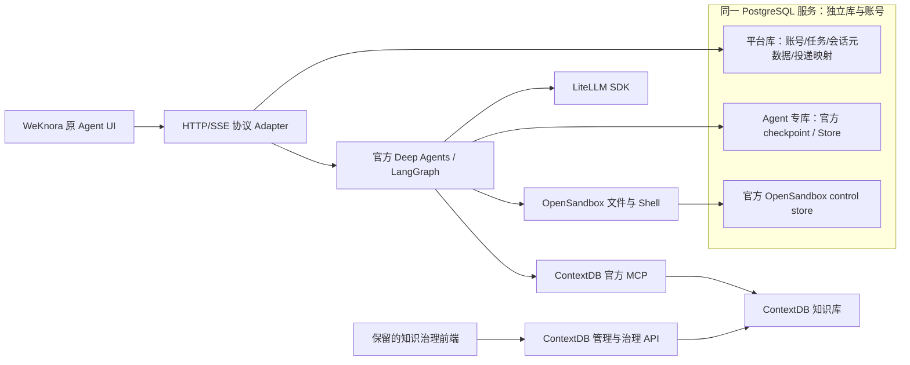

# 架构审查修正总报告与整改验收

日期：2026-11-16，Asia/Shanghai。本文合并复核结论和本轮实施结果，覆盖当前工作树；旧审查及旧验收数字仅是历史记录，不代表当前状态。

## 1. 已确认的执行边界

| 边界 | 最终执行方式 |
| --- | --- |
| 知识库 | ContextDB 是唯一知识治理与知识检索系统；原有采集源快照用于追溯，不建立 PostgreSQL 知识索引或另一套 RAG。 |
| 知识库前端 | 用户明确保留 ContextDB 相关前端。不能把这部分存量定制页面列为本轮应删除的违规 UI；后端真实缺陷继续修复。 |
| Agent 前端 | 采用固定 WeKnora 官方源码，协议转换留在后端；不新增交互或模型配置控件。 |
| Agent 运行 | 免费开源 Python Deep Agents、LangGraph 原生调用，LiteLLM SDK 接入模型；知识工具经 ContextDB 官方 MCP。 |
| PostgreSQL | 用户确认同一 PostgreSQL 服务内使用独立数据库和独立受限账号；不引入 SQLite。平台库与 Agent checkpoint/Store 专库双向拒绝连接。 |
| 生产沙箱 | 用户确认当前没有 Linux/Kata 或 Kubernetes 环境，本轮交付官方部署方案和待验收清单。生产强化隔离未计为已验收。 |
| 既定未接能力 | 保留原 UI，由 API 明确拒绝；不把“入口存在”或“可以保存字段”冒充运行支持。 |

固定源码基线：[WeKnora cbdcebabf48c5ee2d6868b370326aa8341703f62](https://github.com/Tencent/WeKnora/tree/cbdcebabf48c5ee2d6868b370326aa8341703f62/frontend)。本轮按安装版本核对 `deepagents 0.7.35`、`langgraph 1.2.20`、`langgraph-checkpoint-postgres 3.2.0`、`opensandbox 1.2.1`、`langchain-sandbox-opensandbox 0.1.2`、`langchain-litellm 0.11.1`、`litellm 1.109.1`；没有为追随主分支而无关升级。

官方 Deep Agents 的 backend、middleware、checkpointer、Store 和流接口均是允许的集成扩展点。MCP 权限校验、引用真实性检查、OAuth 凭据保存和协议转换有明确用途，不能仅按文件自写或行数判断为冗余。模型重试使用 SDK 原生选项；没有为本轮失败添加私有重试、切换模型或宿主执行兜底。

## 2. 已确认问题及修复结果

| 优先级 | 确认问题 | 修复与证据 | 验收标准 |
| --- | --- | --- | --- |
| P0 | Agent checkpoint/Store 与平台支持记录共用数据库和应用连接账号，无法满足最新隔离边界。 | `agent/checkpointer.py` 强制 `AGENT_DATABASE_URL`，缺失、同库或同账号拒绝；执行锁、会话变更锁和 trace 检查统一连接 Agent 库。实际完成本机复制、权限切换及内容校验。 | 两账号无高权限，本库可访问、双向跨库连接拒绝；原 checkpoint ID、pending writes、Store 保留；平台账号不可读源库旧 checkpoint。 |
| P0 | 聊天文档解析及模型调试图片校验在宿主进程执行。 | `webapi/chat_resources.py`、`webapi/runtime_settings.py` 使用官方 OpenSandbox SDK；固定非 root 解析镜像，空凭据、无宿主卷、出网默认拒绝、解析结束销毁。聊天原始附件按账号/会话归档，不再把宿主路径作为运行时读取入口。 | 六类文档与图片有效性实测；无服务或坏文件明确失败；测试证明不调用宿主解析、不在校验前调用模型、不私有重试。 |
| P1 | 通用 Agent 设置被知识库定制壳承接，原版页面助手和记忆设置组件未完整复用。 | 恢复原版 `AssistantPanel.vue`、`MemorySettings.vue`、`MemoryWorkspaceSettings.vue`；平台 wrapper 按知识库与 Agent 领域选择既有设置壳，保留知识库 UI。 | 恢复组件与固定上游一致；原助手可发送、刷新、读历史；助手会话不混入普通列表；原模型设置及知识库设置分别可操作。 |
| P1 | WeKnora embedded assistant 的 `web_search_enabled=true` 被误作实际开启搜索，后端提前返回 501。 | `webapi/harness.py` 先执行 `resolve_request`，按 Agent 最终有效配置判断；注册服务器管理的隐藏助手，不允许覆盖其配置。 | 原版请求可完成原生 Graph；保存的实际搜索配置仍为 false；真实 Chrome 的回答及完成后历史校验通过。 |
| P1 | ShowDoc、CYB 验证码识别仍绕过统一模型接入层。 | 两处直接使用 `litellm.completion`，保留端点、型号、超时、图像和原错误接口。 | 参数及解析回归通过；未引入第二层模型 fallback 或私有重试。 |
| P1 | 知识库全局搜索前端字段 `query` 与官方 DATA API `question` 不匹配。 | `webapi/contextdb.py` 在现有协议边界转换；相互冲突的双字段返回 400，保留原知识库和文档范围。 | 上游请求仅含官方 `question`，授权范围及其他参数不扩大；冲突拒绝。 |
| P1 | 采集范围元数据和来源 URL 未完整进入 ContextDB，正文未变化时也可能漏掉元数据更新。 | `governance/contextdb_sync.py` 传递 product/version/role/url/filename；保留远端自定义 metadata，以官方元数据 API 更新；不重复上传正文或制造新评审。 | 来源字段更新、陈旧来源字段移除、自定义 tags 保留；重复同步幂等；丢失响应后读回恢复；待评审场景不伪装完成。 |
| P2 | 可用 Skills 与官方目录/安装列表接口不一致，选择沙箱后看不到已可注入的指令。 | `webapi/skill_runtime.py` 按真实 owner 和可用 bundle 投影 `instructions_only`，支持两个内建 backend；不创建假安装任务。 | 目录及文件可按真实 ID 读取；跨账号拒绝；scripts/execution 均不虚报可用；历史安装执行入口仍明确拒绝。 |
| P3 | 未挂载的旧桥接代码保留了另一套知识目录、共享和组织实现。 | 删除无导入、无 Blueprint 注册的 `webapi/knowledge_interactions.py`、`webapi/sharing.py` 以及仅被该桥接引用的 `agent/sharing.py`。 | 全量后端回归通过；现有路由、权限和知识库前端保持工作；未删除业务数据。 |

前端菜单 running/unread 活动链的浏览器验证已通过。需注意：任务起始归档中的菜单文件已经包含该活动链，不能将该归档误称为菜单更早修改前的证据。

## 3. 当前架构与存储切换

本机实际使用 `showdoc_knowledge / showdoc_platform`、`showdoc_agent / showdoc_agent`、`opensandbox_control / opensandbox_control`。第三库承接 OpenSandbox 官方原生 PostgreSQL store，没有增加数据库服务或自建控制状态实现。六个交叉连接方向均被拒绝。

切换前确认 API、治理 Worker 无运行进程，源业务库无其他 client backend；私有 `.env` 与 `pg_dump -Fc` 备份留在 Git 忽略目录。平台九表逐表行数与内容 SHA256 前后一致。Agent 六表二进制 COPY 并逐表核验：262 个 checkpoint、72 个 blob、357 个 write、10 条 checkpoint migration、4 条 Store migration，Store 当时为空。切换后 5 个原生会话均能读取 head，未调用模型或重放工具。

旧 Agent 六表保留为管理员归档，平台账号无法读取；未删除原始业务数据。现有 0 个聊天附件，因此没有遗留 path-only 附件需要迁移；其他部署若存在旧附件，运行时返回 410 并要求受控迁移或重新上传，不回退宿主路径读取。

隔离工具默认只读，目标非空且内容不同则拒绝；COPY 失败回滚数据事务，角色/数据库准备步骤独立记录，不能声称整个准备过程可单事务撤销。源旧表物理清理仍须在备份及切换验收后单独审查，不包含在自动迁移中。

操作说明：[PostgreSQL 隔离指南](../guides/agent-postgres-isolation.md)。原始脱敏证据位于 `output/architecture-remediation-20261116/postgres-isolation-result.json`、`control-postgres-result.json`、`postgres-reconnect.json`。

## 4. 前端源码证据与保留清单

当前官方门禁核对 132 个组件：126 个完整源码、6 个 template/style；另核对 32 项字体、布局和数据层依赖，4 个既定 import 重定位及 2 个官方原版复制映射，独立哈希核验没有失败。

对任务起始归档覆盖的 1089 个前端文件比较：1086 个不变，0 删除，三个差异为官方来源 manifest、平台领域选择 wrapper、路由设置测试。180 个受检 ContextDB 相关前端文件均不变；新增官方组件和领域测试单独记录。这证明受检源码范围，不能外推为全部页面、全部浏览器、全部状态的像素一致。

保留的知识库采集、任务、治理、Wiki、权限及其存量定制组件属于用户明确例外。`ReviewView.vue`、`SettingsView.vue`、`StructuredFields.vue` 等知识治理存量文件未擅自删除；未把它们接入 Agent 展示链以绕过原组件。

官方 UI 门禁：`frontend/UPSTREAM-AGENT-UI.json`、`frontend/src/official-agent-ui.test.ts`。独立证据：`output/architecture-remediation-20261116/frontend-preservation-evidence.json`。

## 5. 尚未完成或不能由本机结果证明的事项

| 项目 | 当前准确状态 | 后续落地与验收 |
| --- | --- | --- |
| 生产隔离 | 本机 runc 为受限开发环境；没有 Kata、生产 Gateway、目标 CNI 或多租户安全证据。 | 按[生产方案](../../deploy/opensandbox.production.md)部署官方 Kubernetes/Kata/Gateway；接入前改为 Gateway 数据面与 `secure_access=True`，锁定远程镜像 digest，逐项完成清单。用户已同意本轮先交付方案。 |
| 浏览器/桌面与运行中 steer、后台续跑 | 明确不支持，未以普通异步调用或 checkpoint 冒充。 | 只有免费官方组件能提供完整协议时再接入；否则保持明确拒绝，不增加自制调度器。 |
| 结构化记忆 | 原生 Store 文件记忆可用；WeKnora 主题/提炼/审批/向量召回不等同于文件记忆，相关接口明确不支持。 | 若未来需要，单独确认业务语义及官方实现；禁止混入 ContextDB 长期记忆或另一套本地知识索引。 |
| Skills 安装和附带脚本 | 指令 bundle 可注入；虚拟 Skills 不等于真实 Shell 文件，自动安装/脚本执行未启用。 | 不能把 instructions_only 的 ready 状态理解为环境安装完成。若启用须使用官方沙箱路径与权限，另做验收。 |
| 子轨迹 | 默认原生完整 AgentState 子图可读；任意动态稀疏 DeltaChannel 子图仍 501；跨 worker 实时附着仍 409。 | 使用官方水合/流接口并证明身份与父子隔离；不私自重建 channel、不建立影子 run 服务。当前部署保持单 worker/粘连边界。 |
| 沙箱历史产物 | checkpoint 内产物可读；当前真实容器文件不具有消息级历史版本，相关接口 501。 | 按既定边界不新增快照系统，不把当前文件冒充历史文件；fork/rewind 不撤销真实外部副作用。 |
| ContextDB 能力 | Wiki 编译接管、原生历史全文/回滚、严格人工发布等公开契约仍须按专项证据确认。 | 沿用官方治理，不本地重写编译器或将接受上传显示为治理完成。metadata 全量替换 API 没有 CAS，不能承诺与云端并发人工编辑无冲突。 |
| 全站视觉与外部供应商 | 官方源码门禁和列明 Chrome 流程通过；不等于全站像素、全部厂商真凭据或生产负载验收。 | 用目标环境和实际账号补充；不把本地协议服务的结果称为全部厂商云端实测。 |

本轮没有未决的 PostgreSQL/知识库前端范围问题；这两项已由用户决策。未来若要求启用上述业务能力或删除保留的知识库前端，需要新的明确范围，不能作为本次“修复”的隐含扩展。

## 6. 回归结果与优先级验收

| 验证 | 实际结果 | 证据及限界 |
| --- | --- | --- |
| 后端默认全量 | 694 passed、15 条件性 skipped，162.80 秒 | `backend-final.log`；跳过项随后按真实环境分批启用，不将 skipped 计为通过。 |
| PostgreSQL 隔离及连接门禁 | 15 passed | `postgres-tests.log`；真实受限账号、独立库、复制后原中断恢复、Store、失败回滚、内容冲突与历史授权检查。 |
| 前端全量 | 363 个文件，2831 passed、0 failed；唯一 opt-in 随后真实 Chrome 1/1 passed | 类型检查、构建、i18n 及官方源码门禁通过。 |
| 主要 Chrome 流程 | 4/4 passed；助手完成状态加强后单项 1/1 passed | 原模型设置/思考/审批/刷新、标题、助手、侧栏 running/unread；真实浏览器及隔离数据库，外部 API 为契约替身。 |
| 真模型与采集浏览器 | 百炼 thinking/tool/审批/重连 1/1 passed；真实 Chromium 爬虫 1/1 passed | 模型使用实际供应商；爬虫针对本地确定性 HTTP 站点，不是外部业务站点采集成功保证。 |
| 真 ContextDB | 隔离库上传、metadata-only PUT、读回、限定范围 `question` 查询通过 | `contextdb-live.json`；tags 保留，PUT 前后云端正文 hash 不变，两轮临时库/文档均确认删除；未写已有知识库。 |
| 真实解析与沙箱 | 镜像恢复后整组 28 passed，57.67 秒 | `sandbox-final.log`；固定镜像覆盖 TXT、DOCX、PPTX、XLSX、文本/扫描 PDF、有效/无效图片、HTTP 上传/预览、二进制、双会话与 PTY；生产安全不在本机证明范围。 |
| 依赖与差异 | 215 个已安装 Python 包兼容；`git diff --check` 通过 | 不等于全部传递依赖及捆绑资产的完整许可证审计。 |

生产清单的 P0 条件在目标环境提供前保持待验收。P1 的协议、元数据、统一模型与原助手链路以实际断言和读回为准；P2 的 Skills 指令只验真实注入能力；P3 只删除确认未挂载桥接，不清理用户数据或知识库前端。

默认跳过的 15 项已分批补测：9 项真实沙箱/附件、4 项 Agent Chrome、1 项真实百炼、1 项 Chromium 爬虫，均取得通过结果。总览与证据散列见 `output/architecture-remediation-20261116/verification-summary.json`。最终清理确认临时沙箱、临时测试账号、迁移用临时数据库均为 0，控制服务健康检查 200；共用的两个 `_test` 库保留供后续回归。

沙箱补测期间 Docker 事件显示解析镜像及执行组件镜像发生 untag/delete，发起方未确认；同一阶段出现一次 egress 启动失败，其具体原因未确认，随后复验因缺镜像拉取失败。失败日志保留，没有添加应用重试。解析镜像已按原构建恢复为同一 digest `sha256:6ed0208861844bafbb249c6d9e837e365d78d252ad6f76c7a40dd01b77423a4c`；恢复后扫描 PDF 单项通过，再执行完整沙箱组 28/28 通过。不能将前两次失败从记录中抹除，也不据此承诺镜像不会再次被外部清理。

ContextDB 初次探测错误地要求云端下载表示等于创建文本的原始字节，未据此修改 SDK；随后按同一文档 metadata PUT 前后表示做一致性验证并通过。原始上传字节与云端下载表示一致性未得到证明；本次通过不等于 Wiki/图谱/全部治理流程均已完成。
