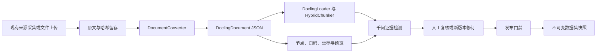

> 适用范围更新：本文件描述原独立爬虫的离线导出链路；平台 Worker 已改为源内容采集和官方 ContextDB 解析、切片。当前架构见 [agent-platform.md](agent-platform.md)。

# Docling 治理实现依据

核对日期：2026-11-12。本次实现阅读官方文档与源码，并在 Python 3.12 环境运行真实转换、分块与千问调用。

| 依赖 | 固定版本 | 核对的官方源码 |
|---|---|---|
| docling-slim | 2.150.0 | [docling ca9a4e0](https://github.com/docling-project/docling/tree/ca9a4e0cfd947e56cf4d24ebff2ca21ba74884fa) |
| docling-core | 2.106.0 | [docling-core fa12a43](https://github.com/docling-project/docling-core/tree/fa12a43fa925e385f6e6d2607df3637e9aa1a3f8) |
| langchain-docling | 3.0.0 | [docling-langchain 5e8f403](https://github.com/docling-project/docling-langchain/tree/5e8f40369d0f724798899e3ba45844c4cd6fa57a) |

官方接入说明：[集成目录](https://docling-project.github.io/docling/integrations/)、[LangChain 集成](https://docling-project.github.io/docling/integrations/langchain/)。

## 实际处理链

- `common/converter.py` 统一格式转换；采集器只负责获得原始内容，不再生成另一份清洗 Markdown。HTML/Markdown 使用 Docling 对应后端；PDF 使用标准 PDF pipeline。
- 先保存结构化 Docling JSON，再让官方 `DoclingLoader` 读取 JSON 分块。避免为切块重复 PDF/OCR 推理；保留 `dl_meta` 与 `node_refs`。
- 预览、Markdown、证据节点、表格和分块来自同一个结构化文档。业务元数据由平台补入，不假定 Loader 默认携带来源系统全部字段。
- Docling 2.150.0 Markdown 后端会在转换前缩短下划线/横线，并对代码尾部 `rstrip`。本项目在该 Docling 后端上仅覆写这些会改坏代码字面量的步骤，保留官方解析流程；升级时必须重跑代码完整性回归。
- HTML 文档片段关闭 `infer_furniture`，防止正文开头的说明被当作装饰内容丢弃。图片引用与相对链接在结构化节点上处理。网页外链图片保留原 URL，不伪装成已下载或已理解的内容。

## 治理边界

Docling 提供文档理解和结构化能力，不提供完整业务歧义裁决、来源权限系统、任务队列或发布版本库。其 OCR/layout confidence 不能解释为业务语义正确概率。

固定流程在 `governance/worker.py` 执行；ContextDB 治理库（`_governance`）记录任务、当前文档版本和发布。执行子进程受任务 claim、attempt 校验和超时约束；应用重启后恢复无存活执行者的任务。原文不被修订覆盖。

本地只做规则格式检查（`common/quality.py`），不调用模型。语义诊断（逻辑、噪声、矛盾、跨文档冲突与重写建议）由发布同步后的 ContextDB 知识评审完成，人工在知识库页面处置或在入库后修订正文并触发新评审。

发布检查任务完整性、源完整性和语料非空，并生成完整当前知识库快照。已发布历史快照可重新启用。

## 尚需用业务样本确定的部分

构造测试只能验证机制与已知场景，不能证明生产准确率。实际验收应分别衡量：源采集覆盖、文字/表格解析、候选召回、问题 precision/recall、人工误报处置成本。扫描质量、产品别名、角色交叉、版本适用区间和正文省略条件都会影响结果。当前单 worker、全知识库检测缓存适合先验证小规模业务集；更大规模应先测量瓶颈再决定增量索引和并行策略。
